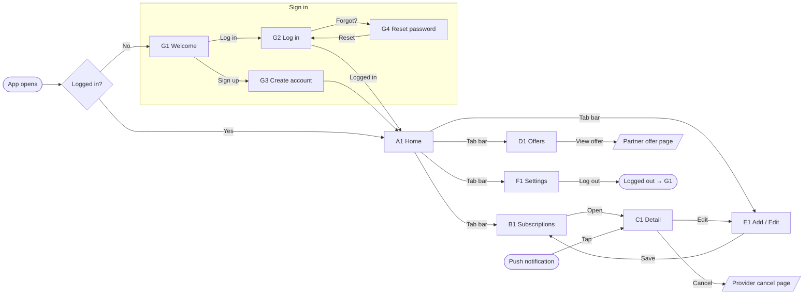

<p align="center">
  
</p>

# WorthIt — Design

WorthIt shows everyday people what they pay for each month and whether it's worth it.

This document describes the WorthIt mobile app design: principles, design tokens, every screen, the app flow and the push notification templates. The source design lives on a Claude Design canvas (private until shared from its Share menu): https://claude.ai/code/artifact/10dbff30-29ad-4924-8859-83857c3abc7a

All names, prices and people in this document are fictional sample data.

---

## 1. Audience and principles

**Who it's for:** low- to middle-income households and working adults on a tight monthly budget. Not finance experts.

**How it should feel:** calm, clear and trustworthy. A friend who's good with money, not a bank.

| Principle | What it means in the design |
|---|---|
| One key number leads every screen | Monthly total on Home, savings on Offers, your share on a split plan |
| Plain language, no jargon | "Next payment", "Your share", "Cancel subscription" |
| Big readable numbers | Totals at 36px bold, tabular figures for every amount |
| Never colour alone | Every status uses colour + icon + text label |
| Honest, never judgemental | "Trial ends in 2 days", never "you're wasting money" |
| No brand logos for services | Services show a letter initial in a coloured circle |

---

## 2. Design tokens

### Colour

| Token | Hex | Use |
|---|---|---|
| Background | `#F7F7FB` | App background |
| Card | `#FFFFFF` | Cards, inputs, tab bar |
| Text | `#16161D` | Primary text |
| Text secondary | `#6B6B7B` | Captions, labels, meta |
| Primary | `#4F46E5` | Buttons, active tab, links, switches |
| Primary dark | `#4338CA` | Link hover, text on primary tint |
| Primary tint | `#EEF0FF` | Secondary buttons, "Trial" and "Split" tags |
| Border | `#E4E4EC` | Card and input borders |
| Divider | `#EFEFF4` | Row dividers inside cards |

**Status colours** (always paired with an icon and a word):

| Status | Background | Text | Icon colour | Icon | Used for |
|---|---|---|---|---|---|
| Alert / trial | `#FFF4E5` | `#9A3412` | `#C2410C` | clock, card, trend-up | Heads-up alerts, trial ending, card expiring |
| Saving / paid | `#F0FDF4` | `#15803D` | `#15803D` | trend-down, check, tag | Better deals, "Paid", cheaper offer |
| Pending | `#FEFCE8` | `#854D0E` | `#CA8A04` | clock | Split share "Not paid yet" |
| Danger | `#FFFFFF` | `#B91C1C` | `#DC2626` | alert-circle, external | Validation errors, Cancel subscription, Log out |

Text colours are darker than the icon colours on purpose, so every label passes WCAG AA contrast (4.5:1).

**Category colours** (dashboard bar and legend):

| Category | Hex |
|---|---|
| Transport | `#4F46E5` |
| Fitness | `#0D9488` |
| Entertainment | `#A5B4FC` |
| Music | `#DB2777` |
| News | `#94A3B8` |
| Software | `#1E293B` |

Neighbouring segments differ in lightness as well as hue, so they can be told apart without colour vision.

### Typography

Font: **Inter**, with tabular figures (`font-variant-numeric: tabular-nums`) on all amounts.

| Style | Size / weight | Use |
|---|---|---|
| Big total | 36px bold | The lead number on a screen |
| H1 | 24px bold | Screen titles |
| H2 | 18px semibold | Section titles |
| Body | 15px regular | Most text, inputs, buttons |
| Caption | 13px | Labels, meta, chips |
| Tab label | 12px medium | Bottom tab bar |

### Shape and depth

| Element | Radius |
|---|---|
| Cards | 16px |
| Buttons, inputs | 12px |
| Chips, tags, badges | 8px |

Shadows are very soft: `0 1px 2px rgba(22,22,29,0.04), 0 4px 12px rgba(22,22,29,0.04)`.

Touch targets are at least 44px tall.

### Recurring components

- **Service initial:** a 32–56px circle with a tinted background and a dark letter (S for StreamBox, F for Flixly, etc.).
- **Payment card chip:** brand and last 4 digits only, with a coloured dot, e.g. `● Visa •• 4821`. A card expiring soon gets a small orange warning triangle with the label "Card expires soon" for screen readers.
- **Tags:** "Trial" (primary tint), "Split · your share €4.67" (primary tint, people icon), "Cheaper offer" (green, tag icon).
- **Switch:** 51 × 31px; primary when on, `#D4D4DE` when off.

---

## 3. Navigation

Frames are 390 × 844 (mobile).

Persistent bottom tab bar on Home, Subscriptions, Offers and Settings:

```
Home   Subscriptions   ( + )   Offers   Settings
```

The central **+** opens Add subscription. Detail, Add / Edit and the sign-in screens open on top with a back arrow.

---

## 4. Screens

### Sign in

| ID | Screen | Contents |
|---|---|---|
| G1 | Welcome | Large logo, "WorthIt", the line "See what you pay every month, and whether it's worth it.", three benefits (all subscriptions in one place, a heads-up before every payment, cheaper deals and shared plans). Buttons: **Create account** (primary), **Log in** (secondary). |
| G2 | Log in | Back arrow, logo, "Welcome back". Email, Password (show/hide), "Forgot password?" link. **Log in**, then "or" with Continue with Apple / Google. Footer: "New to WorthIt? Create account". |
| G3 | Create account | First name, Email, Password with helper "Use 8 or more characters, with a number.", terms checkbox. **Create account**, then Apple / Google. Footer: "Already have an account? Log in". |
| G4 | Reset password | Lock icon, "Reset your password", Email, **Send reset link**. Variant: green "Link sent" confirmation. Footer: "Back to log in". |

### App

#### A1 · Home (Dashboard)
- **Header:** "November" and the monthly total, **€143.73 / month**.
- **Where it goes:** one horizontal stacked bar by category with a legend; "Biggest: Transport €53.90".
- **Heads up** (max 3, soft orange): "Flixly trial ends in 2 days", "Visa •• 4821 expires before your next gym payment", "The Ledger news app went up €2".
- **Next 30 days:** date + weekday, service initial, name, card chip, amount; "See all".
- **Better deal found:** "PowerGym → FitClub", "€19.90 instead of €29.90 a month", green "Save €10.00 / month", **See offers** → D1.

#### B1 · Subscriptions
- Title and "10 subscriptions · €143.73 / month".
- Filter chips: All, Entertainment, Music, Transport, Fitness, Other.
- Card filter dropdown: "All cards" (3 cards).
- Subscription cards: initial, name, next payment date, price / cycle, card chip, and a tag where relevant (Trial, Split, Cheaper offer). Yearly plans also show the monthly equivalent ("≈ €6.99 / month").
- The monthly transit pass is a normal subscription in the Transport category.

#### C1 · Subscription detail (example: StreamBox, €13.99 / month)
- Back arrow, initial, name, category tag.
- **Price:** €13.99 / month · Monthly; Next payment Thu 12.11; Paid with card chip.
- **Split the cost:** switch (on). "Family plan · 3 people · even split". Lead number **€4.67 your share / month** with a "Change" link. A row per person: You (pays StreamBox) €4.67, Nora (Paid) €4.66, Jonas (Not paid yet) €4.66.
- **Trial block** (optional variant): "Free trial ends in 2 days. After that you pay €13.99 / month."
- **Cancel subscription:** outlined red button with external-link icon, "Opens StreamBox's cancellation page" (sends the person to the provider's own cancel page).
- **Edit** (→ E1) and **Remove from app** (removes it from WorthIt only, does not cancel).

#### D1 · Offers
- Lead number: **€17.49 / month you could save**.
- **Better than what you have** (checked 04.11):
  - FitClub, €19.90 instead of PowerGym €29.90 → save €10.00 / month
  - StreamBox yearly plan, €119.88 / year = €9.99 / month → save €4.00 / month
  - Melodia Duo, €14.99 split with 1 person = €7.50 your share → save €3.49 / month
- **Popular deals right now:** CineMax+ 3 months for €1 (ends 30.11), CloudBox 200 GB half price for 6 months ("You have this"), PageTurn ebooks first month free ("Popular").
- "View offer" opens the partner's page.

#### E1 · Add / Edit subscription
- Fields: Name, Category (select), Price (with € prefix), Billing cycle (Monthly / Yearly), Next payment date, Trial end (optional), Payment card (select), **Split the cost** switch.
- Validation example: Price empty → red border + "Enter a price, for example 8.99".
- **Save** (primary, full width), **Cancel**.

#### F1 · Settings
- **Account:** profile (name, email), Payment cards ("3 cards", "1 expiring"), Login and security.
- **Notifications:** Payment reminders (on, 2 days before), Trial and price changes (on), New offers and deals (off).
- **Interface:** Appearance (Light), Language (English), Currency and dates (€ · DD.MM).
- **Help and privacy:** Help and support, Privacy and your data, Log out (→ G1).

---

## 5. App flow



Slanted boxes open outside the app, in the browser. Rounded boxes are where a journey starts or ends.

---

## 6. Push notification templates

Words in `{braces}` are filled in for each person. All notifications show the WorthIt app icon.

| Template | Title | Body | When it's sent | Opens |
|---|---|---|---|---|
| Payment reminder | `{service} payment in {days} days` | `€{amount} goes out on {date} from {card}.` | `{days}` days before each payment, 09:00 (set in Settings) | C1 Detail |
| Trial ending | `{service} trial ends in {days} days` | `After {date} you pay €{amount} a month. Cancel before then if you don't want it.` | 2 days before the trial ends, 09:00 | C1 Detail |
| Card expiring | `{card} expires soon` | `It runs out before your {service} payment on {date}. Update it to avoid a failed payment.` | Once, 30 days before a card expires, if a payment depends on it | F1 Payment cards |
| Price change | `{service} went up €{change}` | `You now pay €{new} a month instead of €{old}.` | As soon as a new price is found | C1 Detail |
| Better deal | `You could save €{saving} a month` | `{offer} costs €{offer_price} instead of {service}'s €{amount}.` | Only if "New offers and deals" is on; at most 1 a week | D1 Offers |
| Split not paid | `{person} hasn't paid yet` | `{person}'s {service} share of €{share} was due on {date}. Send a reminder?` | 3 days after the payment, if a share is still open | C1 Detail |
| Split paid | `{person} paid €{share}` | `{person}'s {service} share is settled. {paid} of {total} people have paid.` | When someone's share is marked as paid | C1 Detail |
| Monthly summary | `Your {month} in WorthIt` | `{count} subscriptions, €{total} this month. {alerts} things need a look.` | 1st of each month, 10:00 | A1 Home |

**Examples**

- *StreamBox payment in 2 days* — €13.99 goes out on 12.11 from Visa •• 4821.
- *Flixly trial ends in 2 days* — After 06.11 you pay €8.99 a month. Cancel before then if you don't want it.
- *You could save €10.00 a month* — FitClub costs €19.90 instead of PowerGym's €29.90.
- *Your November in WorthIt* — 10 subscriptions, €143.73 this month. 3 things need a look.

---

## 7. Copy and tone

- Short and direct. Honest but never judgemental.
- Say what happens next: "Opens StreamBox's cancellation page", "After that you pay €13.99 / month."
- Dates as **DD.MM**, currency in **euros** (`€13.99`), cycles as "/ month" or "/ year".
- Name the difference between **Cancel subscription** (ends it with the provider) and **Remove from app** (only removes it from WorthIt).

## 8. Accessibility

- Text contrast meets WCAG AA (4.5:1), including small grey captions.
- Status is never shown by colour alone: colour + icon + word.
- Touch targets ≥ 44px; real buttons, links, inputs and labels.
- Icon-only buttons (back, show password, +) have accessible labels.
- The expiring-card warning has a text label for screen readers.

---

## 9. Sample data

| Service | Category | Price | Card | Next payment | Notes |
|---|---|---|---|---|---|
| StreamBox | Entertainment | €13.99 / month | Visa •• 4821 | 12.11 | Split with 3 people |
| Flixly | Entertainment | €8.99 / month | Mastercard •• 0937 | 06.11 | Trial |
| GameHub | Entertainment | €5.99 / month | Mastercard •• 0937 | 18.11 | |
| Melodia | Music | €10.99 / month | Mastercard •• 0937 | 08.11 | |
| Monthly transit pass | Transport | €49.00 / month | Mastercard •• 0937 | 08.11 | |
| Velo bike share | Transport | €4.90 / month | Visa •• 4821 | 22.11 | |
| PowerGym | Fitness | €29.90 / month | Visa •• 4821 | 01.12 | Cheaper offer available |
| CloudBox | Software | €2.99 / month | Mastercard •• 0937 | 20.11 | |
| DocsPro | Software | €83.88 / year | Maestro •• 2210 | 14.03 | ≈ €6.99 / month |
| The Ledger | News | €9.99 / month | Visa •• 4821 | 15.11 | Was €7.99 |

Total: **€143.73 / month**. Visa •• 4821 expires before the PowerGym payment on 01.12.

---

## 10. Design decisions

- **No value verdicts.** An earlier version rated subscriptions by cost per hour of use (Great value / Fair / Overpaying / Unused). This was removed because the app will not use screen-time data. Only the trial status remains.
- **Transport is a normal subscription.** The separate Transport tab was removed; the transit pass sits in the Transport category.
- **Offers and Settings tabs added**, which also balances the tab bar at two tabs on each side of +.
- **Split the cost** added for family and duo plans.
- **Cancel subscription** links straight to the provider's cancellation page.

### Open question

- Should the Home total count the full price of split plans (current: €143.73) or only your share?
