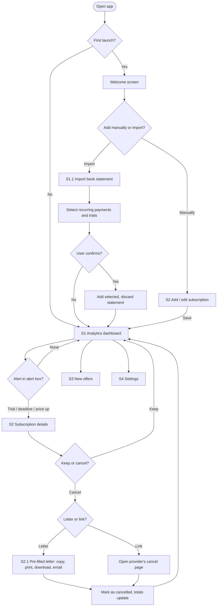

# product.md — Smart Sub Tracker (PRD)

> Structure follows Garrett's Elements of UX: 1 Strategy, 2 Scope, 3 Structure, 4 Skeleton. Research basis: evidence.md.

---

## 1. Strategy

### 1.1 Problem (people problem)
People underestimate how many subscriptions they pay for and what they cost: 6 of 8 interviewees did. Free trials and yearly plans renew without warning, prices rise unnoticed, and cancelling is hard, especially German contracts with minimum terms and written notice periods. The result is wasted money and a feeling of losing control. *(evidence.md, Insights 1–4)*

### 1.2 Target users
- **Primary persona: "Lena", 22, student** (based on P1, P2, P3, P5). Has 7–12 subscriptions and spends around €100–145 per month on a tight budget. Signs up for free trials often. Open to technology but cautious about giving an app bank access.
- **Secondary persona: "Vincent", 48, parent of three** (based on P8, P7). Has few subscriptions of his own but hidden family spending through his kids' in-app subscriptions. Wants an overview by family member. Prefers uploading a statement over a permanent bank connection.

### 1.3 Product objectives and business goals
- **Value proposition:** "See every subscription, never pay for one you forgot."
- **User objectives**
  - Know the real total spend at a glance
  - Never miss a trial end, yearly renewal or cancellation deadline
  - Cancel correctly with a ready-made letter or a direct link
  - Share costs fairly
- **Business model** (the app is free for users)
  1. **User data (anonymised and aggregated, opt-in only):** market insights such as average spend per category or churn after price increases, sold as aggregated reports. Never individual data, and no personal or bank data is kept (see §2.2 Out of scope). GDPR-compliant consent is required.
  2. **Advertisement:** non-intrusive ad slots, e.g. one banner on the New offers screen. Never inside alerts or the cancellation flow.
  3. **Company-sponsored preference:** providers pay to appear as a recommended offer on the New offers screen. Always labelled "Sponsored". *(Users asked for better offers: P2, P4.)*
  4. **B2B bank integration (long term):** license the tracker to banks and neobanks (e.g. Revolut, N26) as a white-label feature inside their apps.

### 1.4 Success metrics

| Perspective | Metric | How it's measured |
|---|---|---|
| **User** | € saved per month | Sum of the monthly prices of subscriptions marked *Cancelled* through the app, plus savings from switching to offers |
| **User** | Satisfaction | In-app rating after a cancellation or import (1–5), and NPS |
| **Company** | User retention | % of users active after 30 and 90 days |
| **Company** | Revenue | Revenue per user from sponsored offers, ads and data reports; number of B2B bank partners |

**Prototype test targets:** 80% of test users add 3 subscriptions in under 2 minutes; users can state their real monthly total after one session; a cancellation letter takes under 30 seconds.

---

## 2. Scope

### 2.1 In scope (functional requirements)

| ID | Feature | Priority | Description | Evidence |
|---|---|---|---|---|
| F1 | Add subscriptions manually | **Must** | Add or edit a subscription: name, price, cycle, start date, category, contract terms | Insight 1 |
| F2 | Import bank statement | **Must** | Upload a CSV bank statement; recurring payments are detected in the browser and the user confirms which to add. The file is discarded afterwards. | Insight 5 |
| F3 | Analytics dashboard | **Must** | Monthly and yearly totals, count, budget bar, spend by category, price change tracker (old → new, %), rule-based savings tips. No AI/LLM. | Insights 1, 4, 7 |
| F4 | Reminders | **Must** | Alert box with reminders before renewals (monthly: 3 days; yearly: 30 days), price increases, cancellation deadlines and budget warnings | Insights 2–4 |
| F5 | Pre-filled cancellation letters + direct unsubscribe link | **Must** | Shows the notice period and last day to cancel; generates a pre-filled letter (EN/DE) to copy, print, download or email; plus a direct link to the provider's cancellation page | Insight 3 |
| F6 | Track free trials | **Must** | Trials with an end date and price after the trial; alert before conversion. Statement import also flags likely trials among everyday transactions (a €0/€1 charge followed by a full-price charge from the same merchant). | Insight 2 |
| F7 | Split subscription costs | **Should** | Split a subscription among members (equal or custom), mark who has paid, assign a subscription to a family member | Insight 6 |
| F8 | Sponsored offers | **Should** | The New offers screen shows sponsored providers and duplicates ("You pay for two music services"). Always labelled "Sponsored". | Insight 7, business model |
| F9 | Personalisation | **Could** | Settings: user info (used in letters, stored on the device only), language (EN/DE), colour theme | — |

### 2.2 Out of scope

| # | Not included | Reason |
|---|---|---|
| O1 | **No info kept after a bank statement import / no personal info taken** | The statement is read once in the browser and then discarded. Only the subscriptions the user confirms are kept, locally on the device. No accounts, no server, no bank logins. |
| O2 | Live bank connection (Open Banking) | Trust (Insight 5) and the "no APIs" rule |
| O3 | Token and usage tracking for AI subscriptions | Business-tool segment (P6); usage-based billing needs provider APIs |
| O4 | Subscription comparison | No side-by-side comparison of plans or prices across providers; New offers only shows sponsored offers and duplicates |
| O5 | Screen time / usage tracking | Not possible in a web app |
| O6 | LLM chat assistant | Dropped by the team; replaced by rule-based tips |

### 2.3 Content requirements
- A catalogue of ~20 services with fictional names (e.g. StreamFlix, TuneBox, CloudVault, FitZone). Each has a category, typical price, notice period, provider address, cancellation email and cancellation URL (all fictional).
- Seed data for one demo user (Lena): 9 subscriptions, including 1 active trial, 1 yearly plan, 1 price increase, 1 shared plan, 1 gym contract with a 3-month notice period and a minimum term, and 1 duplicate (two music services).
- A sample bank statement CSV (~40 rows over 3 months, including 6 recurring payments and 1 trial pattern).
- An offers catalogue of ~10 mock sponsored offers.
- A cancellation letter template in English and German.
- Microcopy: empty states, alert texts, privacy explanation for statement import.

### 2.4 Non-functional requirements
- Prototype runs fully locally: **no external APIs, no real data** (course requirement).
- Statement files are parsed in the browser, never uploaded, and discarded after import.
- Data is persisted on the device only (localStorage).
- Mobile-first, responsive; WCAG AA contrast; large-text friendly (P7).
- Euro currency, German date format.

### 2.5 User stories

| # | User story | Functional requirements | Screens |
|---|---|---|---|
| 1 | As Lena, I want to add a subscription manually, so that my overview is complete. | F1 | S2 |
| 2 | As Vincent, I want to upload my bank statement once, so that hidden subscriptions are found without giving permanent bank access. | F2 | S1 |
| 3 | As Lena, I want to see all my subscriptions and the real total, so that I know where my money goes. | F3 | S1 |
| 4 | As Lena, I want to see when a price went up, so that I can decide if it's still worth it. | F3, F4 | S1, S2 |
| 5 | As Lena, I want to be reminded before a renewal, so that I'm never surprised by a charge. | F4 | S1 |
| 6 | As Lena, I want a ready-made cancellation letter or a direct link, so that I can cancel quickly and my contract doesn't auto-extend. | F5 | S2 |
| 7 | As Lena, I want to be alerted before a free trial converts, so that I can cancel in time. | F6, F4 | S1, S2 |
| 8 | As Lena, I want to split a shared plan and track who has paid, so that I don't have to chase people. | F7 | S2 |
| 9 | As Vincent, I want to see subscriptions grouped by family member, so that I know who spends what. | F7 | S1 |
| 10 | As Lena, I want to see better offers, so that I can pay less. | F8 | S3 |
| 11 | As a user, I want to set my name, language and theme, so that letters and the app fit me. | F9 | S4 |

---

## 3. Structure

### 3.1 Information architecture
Based on the team's whiteboard sketch: a hub-and-spoke structure with the dashboard at the centre.

- **S1 Dashboard** (home, analytics dashboard)
  - Data summary: totals, count, budget bar, spend by category
  - Alert box with reminders
  - Subscription list, filterable by family member
  - "Import bank statement" button → **S1.1 Statement import** (overlay)
  - Savings tips
- **S2 Add / edit subscription**
  - Details, price history, trial and contract terms
  - Split subscription costs
  - Cancellation letter → **S2.1 Letter preview** (overlay) · direct unsubscribe link
- **S3 New offers**
  - Sponsored offers, duplicates
- **S4 Settings**
  - User info, language, colour theme, reminder timing, demo tools

### 3.2 Flow diagram

### 3.3 Data model (entities)
- **Subscription:** id, name, category, price, billingCycle, startDate, nextRenewal, status (active/trial/cancelled), trialEndDate, priceAfterTrial, minimumTermEnd, noticePeriodDays, providerName, providerAddress, providerEmail, cancelUrl, customerNumber, assignedTo, sharedPlanId
- **PriceChange:** id, subscriptionId, oldPrice, newPrice, date
- **SharedPlan:** id, subscriptionId, members[{name, share, paid}]
- **FamilyMember:** id, name
- **Budget:** monthlyLimit
- **Offer:** id, title, description, matchesCategory, monthlyPrice, sponsored
- **UserProfile:** name, address, language, theme (stored on the device only)
- **Alert** (derived): type, subscriptionId, message, dueDate

No statement data is stored (Out of scope O1).

### 3.4 Interaction design: key user flows

**Flow 1: First launch**
1. Welcome screen: "See every subscription in one place"
2. Choose: *Add manually* or *Import bank statement*
3. → S1 Dashboard with totals
4. Prompt: "Set a monthly budget?" (skippable)

**Flow 2: Add a subscription manually (S2)**
1. Search or pick a service from the catalogue, or choose "Custom"
2. Price, cycle and notice period are pre-filled and editable
3. Enter the start date; the next renewal is calculated automatically
4. Optional sections: "Free trial" (end date, price after), "Contract terms" (minimum term end, notice period), "Assign to" (family member), "Split" (members)
5. Save → toast "Added" → back to S1
- Validation: name and price are required; price must be > 0; dates must be valid.

**Flow 3: Import a bank statement (S1.1)**
1. S1 → tap "Import bank statement"
2. Privacy note: "Your file is read on this device only, never uploaded, and deleted after import."
3. Choose a CSV file, or "Use sample statement" for the demo
4. The app lists the recurring payments and likely free trials it found (merchant, amount, interval) with checkboxes
5. Payments that are already tracked are greyed out
6. Tap "Add selected" → the statement is discarded, the dashboard updates, alert: "4 new subscriptions found"

**Flow 4: Cancel (S2 → S2.1 or link)**
1. An alert on S1 says "FitZone: last day to cancel is 30.11.2026"
2. Tap → S2 for FitZone; the contract section shows the notice period, minimum term end and last day to cancel
3. Choose one:
   - **"Create cancellation letter"** → S2.1 shows the letter pre-filled with the user's name and address, provider address, customer number, termination date and the request for written confirmation. Actions: Copy · Print · Download (.txt) · Email provider.
   - **"Cancel online"** → opens the provider's cancellation page in a new tab (mock URL in the prototype)
4. Back on S2: "Mark as cancelled" → status becomes *Cancelled*, totals update, € saved per month increases

**Flow 5: Free trial**
1. A trial is added manually (Free trial section) or detected in the statement
2. S1 alert 3 days before: "CloudVault trial ends in 3 days, then €2.99/month"
3. Tap → S2 → Keep, or cancel via Flow 4

**Flow 6: Price increase**
1. A price change is recorded (seed data, or the user edits the price)
2. S1 alert: "TuneBox went up from €10.99 to €11.99 (+9%)"
3. Tap → S2 shows the price history, with *Keep* or *Cancel*

**Flow 7: Split subscription costs**
1. S2 → "Split" → add members by name
2. Split equally (default) or enter custom amounts
3. Tick *Paid* per member; S1 shows "2 of 3 paid"

**Flow 8: Sponsored offer**
1. S3 lists sponsored offers matched to the user's categories, plus duplicates ("You pay for TuneBox and WaveMusic")
2. Tap an offer → details and the monthly saving, labelled "Sponsored"
3. "Switch" opens S2 for the old subscription with cancellation ready (Flow 4)

---

## 4. Skeleton

> Low-fidelity layout per screen. Visual styling lives in design.md; component names refer to architecture.md §3.

### 4.1 Navigation design
- **Global navigation:** bottom tab bar with Dashboard · New offers (badge with the number of offers) · Settings, visible on S1, S3 and S4
- **Local navigation:** S2 opens as a sub-screen with a back arrow; S1.1 and S2.1 are overlays with a close button
- **Contextual navigation:** tapping an alert or a subscription card opens S2; floating **+ button** bottom-right on S1 opens S2 in add mode
- Mobile-first, 390 px wide; centred at max-width 480 px on desktop

### 4.2 Interface design (screens)

**S1 Analytics dashboard**
1. Header: "Your subscriptions" and a filter chip "Everyone ▾" (family member filter)
2. **Summary card:** monthly total (large), yearly total and number of subscriptions (small)
3. `BudgetBar`: "€118 / €130"; warning state at ≥ 80%, over-budget state at ≥ 100%
4. **Alert box:** up to 3 most urgent `AlertItem`s (trial ends, last day to cancel, price increase, renewal), plus "Show all"
5. Button "Import bank statement"
6. **Spend by category:** small bar chart
7. **Subscription list:** `SubscriptionCard`s with icon, name, price, `CountdownBadge`, `PriceChangeTag` (↑), "Trial" or "Shared 2/3 paid" badge; sortable by price or renewal date
8. **Savings tips:** 1–2 `TipCard`s ("You pay for two music services")
9. Floating + button
10. Empty state: "Add your first subscription", with *Add manually* and *Import statement* buttons

**S1.1 Statement import (overlay)**
1. Title "Import bank statement" + close button
2. Privacy note (lock icon)
3. File picker (CSV) + link "Use sample statement"
4. Results list of detected payments (and likely trials) with checkbox, merchant, amount and interval
5. Primary button "Add selected (4)"

**S2 Add / edit subscription**
1. Header: back arrow + service name (or "Add subscription")
2. Service search + quick-pick chips + "Custom"
3. Fields: Price (€), Billing cycle (Monthly / Yearly), Start date, Category
4. Price history mini chart + price-change notice (edit mode only)
5. Collapsible sections: **Free trial** · **Contract terms** (minimum term end, notice period, "last day to cancel" calculated) · **Assign to** · **Split costs**
6. Buttons: "Save" (primary); in edit mode also "Create cancellation letter", "Cancel online" (direct link) and "Mark as cancelled"

**S2.1 Cancellation letter (overlay)**
1. Title "Cancellation letter" + language toggle EN / DE
2. Letter preview: sender (from Settings), provider address, date, subject "Cancellation of contract / customer no. …", body with the termination date, request for confirmation, signature line
3. Action row: Copy · Print · Download · Email provider
4. Hint if the user info is missing: "Add your name and address in Settings"

**S3 New offers**
1. Header: "New offers"
2. Total possible saving: "Save up to €24/month"
3. `OfferCard` list: title, short reason ("For your music"), price per month, "Sponsored" tag, "View" button
4. Duplicates section: "You might be paying twice"
5. Empty state: "No offers right now"

**S4 Settings**
1. **User info:** name, address, email (used in cancellation letters; stored on this device only)
2. **Language:** English / Deutsch
3. **Colour theme:** Light / Dark / System
4. **Reminders:** days before renewal (1 / 3 / 7); yearly plans 30 days
5. **Family members:** add or remove names
6. **Demo tools:** demo date picker, "Reset demo data" (with confirmation)

### 4.3 Information design
- **Priority:** the most important number leads every screen: the monthly total (S1), the last day to cancel (S2), the possible saving (S3).
- **Alerts are sorted by urgency:** cancellation deadline and trial end first, then price increases, renewals and budget.
- **Status is shown with text plus colour plus icon:** e.g. "↑ +9%" in red, "in 2 days" with a clock icon. Never colour alone.
- **Numbers:** euros with 2 decimals, in German format in DE ("11,99 €") and "€11.99" in EN; dates as DD.MM.YYYY; relative dates for anything within 7 days ("tomorrow", "in 3 days").
- **Charts:** only two: spend by category (S1) and price history (S2). Simple bars with labelled values, no legends needed.
- **Progressive disclosure:** S2 shows the essentials first; trial, contract, assign and split sections are collapsed until needed.

### 4.4 Wireframe sketches
`[Add photos of your whiteboard sketches here, e.g. ]`
